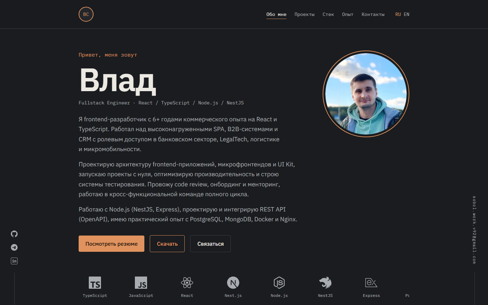
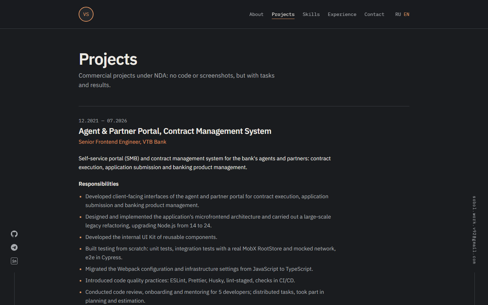
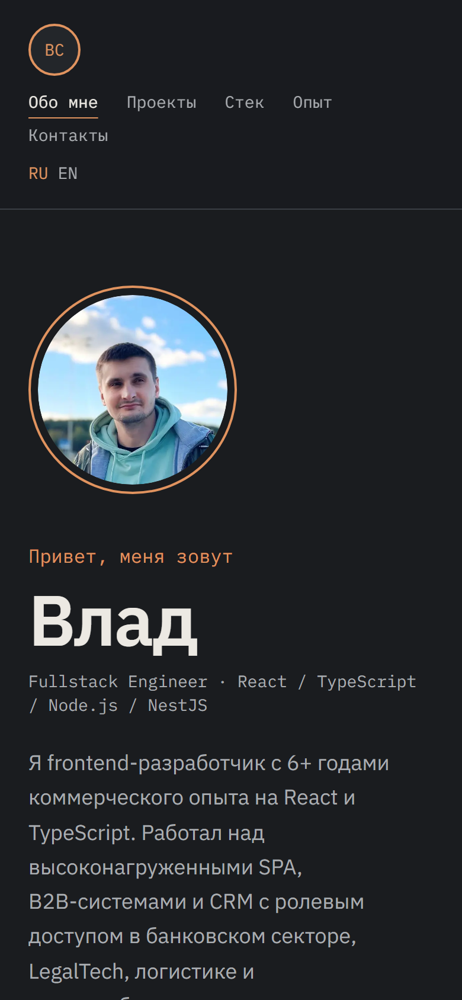
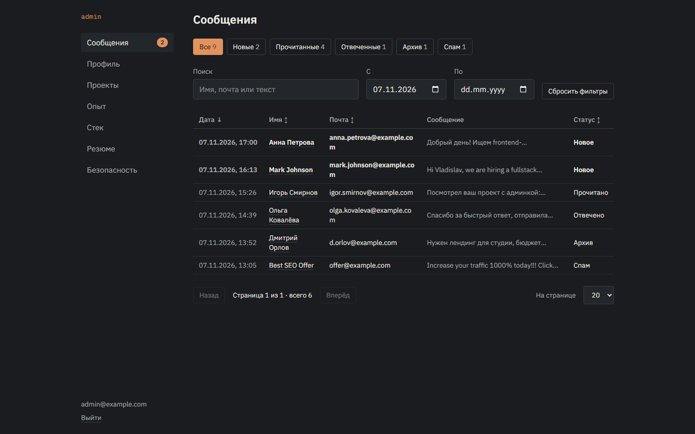
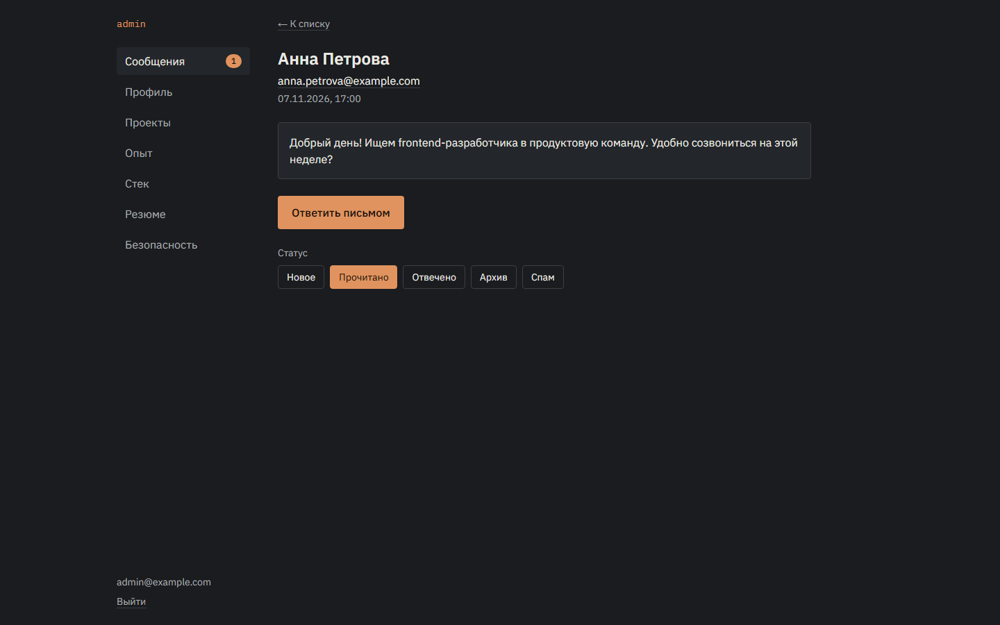
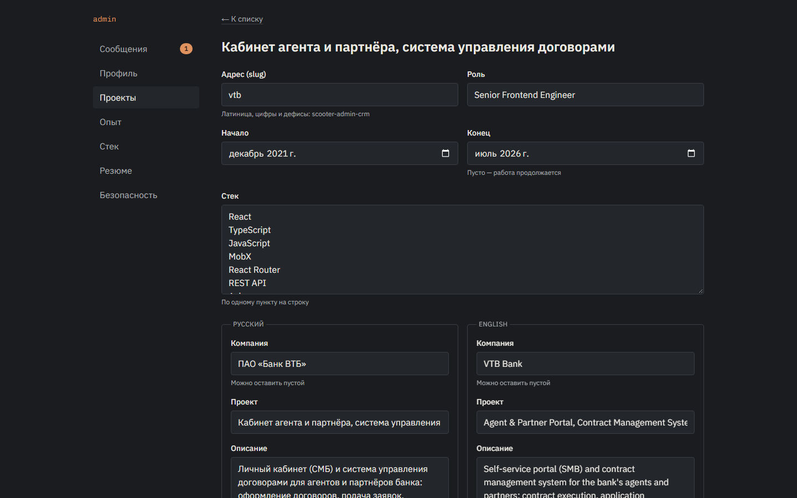
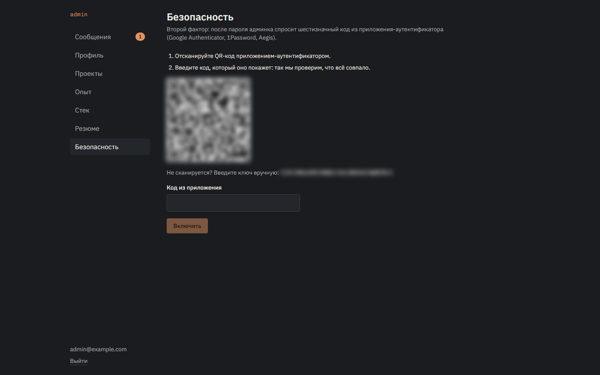
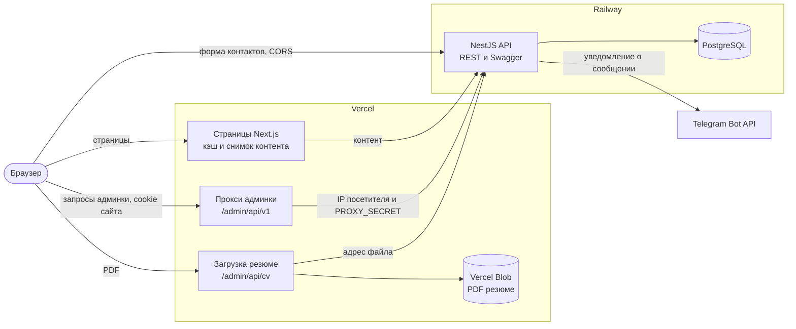

# Портфолио

**Сайт:** <https://my-portfolio-sigma-taupe.vercel.app>

Личный сайт и одновременно fullstack-проект: Next.js, NestJS, PostgreSQL, Docker, CI и тесты всех уровней в одном монорепозитории. Коммерческие проекты под NDA описаны на сайте как кейсы, без кода и скриншотов.



<table>
  <tr>
    <td width="70%"></td>
    <td width="30%"></td>
  </tr>
</table>

<details>
<summary><b>Админка</b>: сообщения, правка контента, второй фактор</summary>






</details>

Скриншоты сняты на демо-данных скриптом `apps/web/scripts/readme-screenshots.mjs`: при запущенном `docker compose` он пересоздаёт их одной командой `node apps/web/scripts/readme-screenshots.mjs`.

## Что умеет

- **Сайт** на русском и английском: обо мне, проекты, стек, опыт, контакты, резюме в PDF. Страницы собираются заранее и продолжают работать, даже если API недоступен.
- **Форма контактов:** проверка на клиенте и сервере одной Zod-схемой, сохранение в базу, уведомление в Telegram, лимит запросов и скрытое поле от ботов.
- **Админка** на `/admin`: вход по паролю и коду из приложения-аутентификатора, таблица сообщений со статусами, поиском, фильтрами, сортировкой и пагинацией на сервере, правка всего контента на двух языках с мгновенным обновлением страниц, загрузка резюме в Vercel Blob.

## Запуск

Нужен только Docker:

```bash
docker compose up --build
```

- Сайт: <http://localhost:3000>
- Swagger: <http://localhost:3001/api/docs>
- Админка: <http://localhost:3000/admin>, локальные логин и пароль заданы в `compose.yaml`

Для разработки нужны Node.js 24 и pnpm:

```bash
pnpm install
cp apps/api/.env.example apps/api/.env
cp apps/web/.env.example apps/web/.env.local
pnpm db:up && pnpm db:migrate && pnpm db:seed
pnpm dev:api   # в одном терминале
pnpm dev:web   # в другом
```

`pnpm db:seed` заполняет только пустую базу. Чтобы вернуть контент к `seed-data.ts`, есть `pnpm db:seed:reset`: она стирает правки из админки. Для входа в админку на `http://localhost:3000/admin` задайте в `apps/api/.env` переменные `ADMIN_EMAIL` и `ADMIN_PASSWORD`: администратор создастся при старте API.

## Архитектура



| Папка             | Что внутри                                         |
| ----------------- | -------------------------------------------------- |
| `apps/web`        | Next.js App Router, Tailwind CSS, React Hook Form  |
| `apps/api`        | NestJS, Prisma, Swagger, миграции и seed           |
| `packages/shared` | Zod-схема формы и константы, общие для сайта и API |

## Почему так

**Монорепозиторий на pnpm workspaces.** Схема формы лежит в одном месте и проверяет данные и в браузере, и на сервере. Изменение API и сайта попадает в один коммит. Turborepo и Nx для трёх пакетов дали бы больше настройки, чем пользы.

**Контракт вместо ручных типов.** NestJS описывает API через Swagger, `openapi.json` лежит в репозитории, а `openapi-typescript` генерирует из него типы для `openapi-fetch`. Если DTO изменился, а контракт нет, тест падает, поэтому сайт и API не расходятся незаметно. GraphQL решил бы ту же задачу, но для нескольких простых GET-запросов он лишний.

**Cache Components вместо сплошного SSR.** Контент меняется редко, поэтому страницы собираются заранее и обновляются в фоне раз в час. Длинный срок хранения кэша нужен, чтобы посетитель сразу получал страницу, даже если API в этот момент недоступен.

**Портфолио работает и без API.** Если API или база лежат, сайт показывает последнюю удачную версию страниц из кэша, а не работают только админка и форма контактов. Чтобы без API собиралась и новая выкладка, в репозитории лежит снимок контента `apps/web/src/lib/content-snapshot.json`: сборка берёт его, если API не ответил. Во время работы сайта снимок не используется, иначе он затёр бы в кэше более свежие правки. Обновить снимок после правок в админке:

```bash
API_URL=https://<адрес API> pnpm --filter @portfolio/web content:snapshot
```

**Два языка.** Сайт живёт на адресах `/ru` и `/en`, поэтому у каждой версии своя ссылка и свой кэш. Подписи лежат в словарях, а контент в таблицах переводов: даты, ссылки и стек хранятся один раз и не могут разойтись между версиями. Компилятор не даст пропустить перевод. Встроенного подхода Next.js хватает, поэтому отдельной библиотеки нет.

**PostgreSQL и Prisma для контента, который правят в админке.** Контент лежит в базе и редактируется в `/admin`, а после сохранения страницы сайта обновляются по меткам кэша. Seed заполняет только пустую базу, поэтому выкладка не стирает правки. Перезаписать контент данными из `seed-data.ts` можно только явно: `pnpm db:seed:reset`. Заодно в базе хранятся сообщения из формы.

**Админка за сервером сайта.** Сайт и API на разных доменах, поэтому браузер ходит в API через прокси на адресе сайта, и cookie сессии принадлежат сайту. Сессия — короткий JWT доступа и токен обновления с ротацией, оба в httpOnly-cookie, а в базе лежит только хеш токена. Сайт передаёт в API IP посетителя вместе с общим секретом, поэтому лимит попыток входа считается для каждого посетителя, и посторонний не может заблокировать вход автору.

**Вход в админку.** Пароль хранится только как хеш argon2. Второй фактор — TOTP по RFC 6238 на `node:crypto`, без сторонних библиотек: его секрет зашифрован AES-256-GCM, а шаг с кодом одноразовый и со своим лимитом попыток. Выход отзывает сессию на сервере. От CSRF защищают `SameSite`-cookie и проверка `Sec-Fetch-Site` и `Origin` в прокси. Каждый эндпоинт админки закрыт проверкой роли, по умолчанию доступ запрещён.

**Форма: сначала база, потом Telegram.** Сообщение нельзя потерять из-за сбоя Telegram, поэтому оно сначала сохраняется, а ошибка уведомления только пишется в лог. От спама защищают лимит запросов с одного IP и скрытое поле (honeypot). Лимит хранится в памяти: для одного экземпляра API этого достаточно, Redis понадобится только при масштабировании.

**Миграции из прод-образа.** Один и тот же образ применяет миграции и запускает API. Railway выполняет `node --run db:release` до старта новой версии: если миграция падает, деплой останавливается, а старая версия продолжает работать. В Docker Compose работает та же команда, поэтому CI проверяет настоящий путь релиза.

**Один слой кэша.** Контент кэширует только `use cache` с профилем `content`. Запросы к API идут с `cache: 'no-store'`: иначе Next.js дополнительно сохранял бы ответы в свой кэш запросов, а Vercel переносит его между сборками, и новая сборка показывала бы старый контент.

**Vercel для сайта, Railway для API и базы.** Vercel лучше всего поддерживает возможности Next.js, а Railway запускает готовый Dockerfile и даёт PostgreSQL в той же приватной сети. Kubernetes и микросервисы для такого проекта только усложнили бы эксплуатацию.

## Тесты

| Уровень                 | Инструменты                        | Команда             |
| ----------------------- | ---------------------------------- | ------------------- |
| Unit и integration      | Vitest, React Testing Library, MSW | `pnpm test`         |
| e2e API на настоящей БД | Vitest, supertest                  | `pnpm test:e2e`     |
| Браузер                 | Playwright                         | `pnpm test:browser` |

GitHub Actions на каждый push в `main` и pull request запускает линт, проверку типов и форматирования, все тесты и подъём проекта в Docker Compose.

## Деплой

**Порядок при смене контракта API.** Vercel собирает сайт сразу после push, а Railway ждёт CI. Если сайту нужны новые поля, сначала выкладывается API, и только потом сайт. Иначе сборка обратится к старому API и упадёт.

### API и база: Railway

1. Создать проект, добавить PostgreSQL и сервис из GitHub-репозитория. В настройках сборки выбрать Dockerfile: Railway собирает его последний этап, то есть `api`.
2. Переменные сервиса:

   | Переменная           | Значение                                                                                                                                                                                  |
   | -------------------- | ----------------------------------------------------------------------------------------------------------------------------------------------------------------------------------------- |
   | `DATABASE_URL`       | `${{Postgres.DATABASE_URL}}`                                                                                                                                                              |
   | `PORT`               | `3001`                                                                                                                                                                                    |
   | `CORS_ORIGIN`        | адрес сайта на Vercel, без `/` в конце                                                                                                                                                    |
   | `TRUST_X_REAL_IP`    | `true`                                                                                                                                                                                    |
   | `TELEGRAM_BOT_TOKEN` | токен бота, необязательно                                                                                                                                                                 |
   | `TELEGRAM_CHAT_ID`   | id чата, необязательно                                                                                                                                                                    |
   | `JWT_SECRET`         | секрет подписи токенов админки, от 32 символов; без него API не стартует. Из него же выводится ключ шифрования секрета второго фактора: после смены второй фактор нужно подключить заново |
   | `ADMIN_EMAIL`        | почта первого администратора                                                                                                                                                              |
   | `ADMIN_PASSWORD`     | его пароль, от 12 символов; после первого запуска переменные можно удалить                                                                                                                |
   | `PROXY_SECRET`       | случайная строка, такая же, как на Vercel                                                                                                                                                 |

3. Настройки сервиса:
   - Pre-deploy Command: `node --run db:release`
   - Healthcheck Path: `/api/v1/health`
   - Public Networking: сгенерировать домен на порт `3001`
   - Wait for CI: включить, чтобы деплой шёл только после зелёного CI

### Сайт: Vercel

1. Импортировать репозиторий и указать Root Directory `apps/web`. Команда сборки лежит в `apps/web/vercel.json`.
2. Переменные окружения:

   | Переменная                     | Значение                                                                                      |
   | ------------------------------ | --------------------------------------------------------------------------------------------- |
   | `API_URL`                      | адрес API на Railway                                                                          |
   | `NEXT_PUBLIC_API_URL`          | тот же адрес                                                                                  |
   | `PROXY_SECRET`                 | тот же секрет, что на Railway: без него лимит входа в админку общий на всех посетителей       |
   | `TRUST_X_REAL_IP`              | `true` для Production и Preview: X-Real-IP там выставляет Vercel. Для Development не задавать |
   | `ENABLE_EXPERIMENTAL_COREPACK` | `1`, чтобы использовать версию pnpm из `package.json`                                         |

3. Для загрузки резюме из админки создать в Vercel **публичное** хранилище Blob и подключить его к проекту: Vercel сам добавит `BLOB_STORE_ID` и выдаст доступ через OIDC. Приватное хранилище не подойдёт: оно не принимает файлы с публичным доступом. Без хранилища сайт отдаёт PDF из `apps/web/public/cv/`.

Почта автора коммитов должна быть подтверждена в аккаунте GitHub владельца проекта Vercel. Иначе на бесплатном тарифе Vercel блокирует сборки из Git, а ручной перезапуск требует тариф Pro.

Порядок важен: сборке сайта нужен работающий API, а API должен знать адрес сайта. Поэтому сначала поднимается Railway, затем Vercel, а после этого в `CORS_ORIGIN` прописывается итоговый адрес сайта.

## Планы

- Раздел «Заметки»: статьи с редактором в админке, на двух языках.
- Open Graph-картинки и `sitemap` для превью ссылок и поисковиков.
