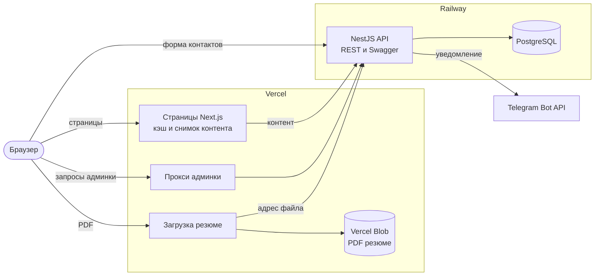

# Владислав Соболь — Software Engineer

React / TypeScript / Node.js / NestJS · 5+ лет коммерческой разработки

**[Сайт](https://my-portfolio-sigma-taupe.vercel.app)** · Резюме: [RU](https://my-portfolio-sigma-taupe.vercel.app/cv/CV_Sobol_Software_Engineer_RU.pdf), [EN](https://my-portfolio-sigma-taupe.vercel.app/cv/CV_Sobol_Software_Engineer_EN.pdf) · [Telegram](https://t.me/VladilenS_tg) · [sobol.work.v92@gmail.com](mailto:sobol.work.v92@gmail.com) · [LinkedIn](https://www.linkedin.com/in/vlad-sobol-59458b214/)

[](https://github.com/MireGo2013/my-portfolio/actions/workflows/ci.yml)


Мой сайт-портфолио и одновременно открытый fullstack-проект, по которому можно оценить, как я пишу код: Next.js и NestJS в одном монорепозитории, PostgreSQL, Docker, CI и тесты всех уровней. Коммерческие проекты под NDA описаны на сайте как кейсы — с задачами и результатами, но без кода и скриншотов.


<table>
  <tr>
    <td width="70%"></td>
    <td width="30%"></td>
  </tr>
</table>

<details>
<summary><b>Админка</b>: сообщения, правка контента, второй фактор</summary>


</details>

## Что умеет

- **Сайт** на русском и английском: обо мне, проекты, опыт, стек, контакты, резюме в PDF. Страницы собираются заранее и продолжают работать, даже если API недоступен.
- **Форма контактов:** одна Zod-схема проверяет данные и в браузере, и на сервере; сообщение сохраняется в базу и приходит в Telegram; от спама — лимит запросов и скрытое поле.
- **Админка:** вход по паролю и коду из приложения-аутентификатора; таблица сообщений со статусами, поиском, фильтрами, сортировкой и пагинацией на сервере; правка всего контента на двух языках с мгновенным обновлением страниц; загрузка резюме.

## С чего смотреть код

| Что                                             | Где                                                                                                                                                              |
| ----------------------------------------------- | ---------------------------------------------------------------------------------------------------------------------------------------------------------------- |
| Второй фактор (TOTP) без сторонних библиотек    | [`auth/two-factor/totp.ts`](apps/api/src/auth/two-factor/totp.ts), шифрование секрета — [`secret-box.ts`](apps/api/src/auth/two-factor/secret-box.ts)            |
| Прокси админки: CSRF, cookie, обновление сессии | [`admin/api/v1/[...path]/route.ts`](apps/web/src/app/admin/api/v1/%5B...path%5D/route.ts), [`api-forward.ts`](apps/web/src/features/admin/server/api-forward.ts) |
| Сайт, который собирается без API                | [`content-fallback.ts`](apps/web/src/shared/content/content-fallback.ts)                                                                                         |
| Общая схема формы для клиента и сервера         | [`packages/shared/src/contact.ts`](packages/shared/src/contact.ts)                                                                                               |
| Переименование таблиц без потери данных         | [`migrations/…_rename_experience_to_work`](apps/api/prisma/migrations/20261109120000_rename_experience_to_work/migration.sql)                                    |
| Браузерный тест: правка в админке → сайт        | [`e2e/admin-content.spec.ts`](apps/web/e2e/admin-content.spec.ts)                                                                                                |

## Архитектура



| Папка             | Что внутри                                                        |
| ----------------- | ----------------------------------------------------------------- |
| `apps/web`        | Next.js App Router, Tailwind CSS, React Hook Form, TanStack Query |
| `apps/api`        | NestJS, Prisma, Swagger, миграции и seed                          |
| `packages/shared` | Zod-схемы и константы, общие для сайта и API                      |

Внутри приложений код сгруппирован по разделам, а не по типу файлов: всё, что относится к одной части сайта или админки, лежит в одной папке вместе с тестами. На сайте это `features/site/*`, `features/admin/*` и `shared/`, в API — `content/`, `admin/` и `auth/`.

## Решения

| Решение                               | Почему                                                                         | От чего отказался                                             |
| ------------------------------------- | ------------------------------------------------------------------------------ | ------------------------------------------------------------- |
| Монорепозиторий на pnpm workspaces    | Схемы общие для сайта и API, изменение обеих сторон — один коммит              | Turborepo и Nx: для трёх пакетов настройки больше, чем пользы |
| Контракт OpenAPI вместо ручных типов  | Типы фронта генерируются из Swagger, тест падает, если контракт отстал от кода | GraphQL: лишний для нескольких простых запросов               |
| Cache Components вместо сплошного SSR | Контент меняется редко: страницы готовы заранее и обновляются в фоне           | SSR на каждый запрос                                          |
| Сайт работает без API                 | Кэш страниц плюс снимок контента для сборки                                    | Падающая сборка при недоступном API                           |
| PostgreSQL и Prisma                   | Контент правится в админке, seed заполняет только пустую базу                  | Контент в файлах репозитория                                  |
| Админка за сервером сайта             | Сайт и API на разных доменах, cookie сессии принадлежат сайту                  | Сторонние cookie от API                                       |
| Сначала база, потом Telegram          | Сбой Telegram не теряет сообщение                                              | Отправка только в Telegram                                    |
| Миграции из прод-образа               | Один образ применяет миграции и запускает API, CI проверяет тот же путь        | Отдельный скрипт миграций                                     |
| Vercel и Railway                      | Лучшая поддержка Next.js и готовый Dockerfile с PostgreSQL рядом               | Kubernetes и микросервисы                                     |

<details>
<summary><b>Подробнее о решениях</b></summary>

**Контракт вместо ручных типов.** NestJS описывает API через Swagger, `openapi.json` лежит в репозитории, а `openapi-typescript` генерирует из него типы для `openapi-fetch`. Тест сравнивает `openapi.json` с тем, что отдаёт запущенный API: если DTO изменился, а контракт нет, CI падает, поэтому сайт и API не расходятся незаметно.

**Cache Components.** Страницы собираются заранее и обновляются в фоне раз в час. Длинный срок хранения кэша нужен, чтобы посетитель сразу получал страницу, даже если API в этот момент недоступен.

**Портфолио работает и без API.** Если API или база лежат, сайт показывает последнюю удачную версию страниц из кэша, а не работают только админка и форма контактов. Чтобы без API собиралась и новая выкладка, в репозитории лежит снимок контента: сборка берёт его, если API не ответил. Во время работы сайта снимок не используется, иначе он затёр бы в кэше более свежие правки.

**Два языка.** Сайт живёт на адресах `/ru` и `/en`, поэтому у каждой версии своя ссылка и свой кэш. Подписи лежат в словарях, контент — в таблицах переводов: даты, ссылки и стек хранятся один раз и не могут разойтись между версиями. Компилятор не даст пропустить перевод. Встроенного подхода Next.js хватает, отдельной библиотеки нет.

**Админка за сервером сайта.** Браузер ходит в API через прокси на адресе сайта, поэтому cookie сессии принадлежат сайту, а не стороннему домену. Сессия — короткий JWT доступа и токен обновления с ротацией, оба в httpOnly-cookie, в базе лежит только хеш токена.

**Вход в админку.** Пароль хранится только как хеш argon2. Второй фактор — TOTP по RFC 6238 на `node:crypto`, его секрет зашифрован AES-256-GCM, шаг с кодом одноразовый и со своим лимитом попыток. Выход отзывает сессию на сервере. От CSRF защищают `SameSite`-cookie и проверка источника запроса в прокси. Каждый эндпоинт админки закрыт проверкой роли, по умолчанию доступ запрещён.

**Форма контактов.** Сообщение сначала сохраняется, а ошибка уведомления только пишется в лог. Лимит запросов хранится в памяти: для одного экземпляра API этого достаточно, Redis понадобится только при масштабировании.

**Миграции из прод-образа.** Railway применяет миграции этим же образом до старта новой версии: если миграция падает, деплой останавливается, а старая версия продолжает работать. Docker Compose запускает ту же команду, поэтому CI проверяет настоящий путь релиза.

</details>

## Тесты

| Уровень                 | Инструменты                        | Тестов | Команда             |
| ----------------------- | ---------------------------------- | -----: | ------------------- |
| Unit и integration      | Vitest, React Testing Library, MSW |    215 | `pnpm test`         |
| e2e API на настоящей БД | Vitest, supertest                  |     78 | `pnpm test:e2e`     |
| Браузер                 | Playwright                         |     52 | `pnpm test:browser` |

GitHub Actions на каждый push в `main` и pull request запускает линт, проверку типов и форматирования, все тесты, браузерные тесты на продакшен-сборке и подъём всего проекта в Docker Compose.

## Запуск

Нужен только Docker:

```bash
docker compose up --build
```

- Сайт: <http://localhost:3000>
- Swagger: <http://localhost:3001/api/docs>
- Админка: <http://localhost:3000/admin>, локальные логин и пароль заданы в `compose.yaml`

Запуск без Docker, деплой на Vercel и Railway, переменные окружения — в [DEPLOY.md](DEPLOY.md).

## Планы

- Раздел «Заметки»: статьи с редактором в админке, на двух языках.
- Open Graph-картинки и `sitemap` для превью ссылок и поисковиков.

## Лицензия

Код — [MIT](LICENSE). Тексты о себе, фотография и резюме — личные, под лицензию не входят.
